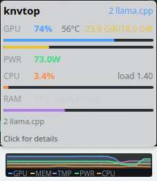
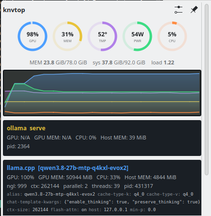
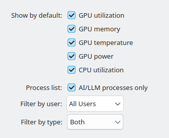

# knvtop

A KDE Plasma 6 widget that shows nvtop-style GPU telemetry (utilization,
memory, temperature, power, plus CPU%) as a compact multi-line graph in the
panel, expanding into a detail popup with per-process cards for local LLM
inference servers (llama.cpp, ollama, vllm) and — optionally — every
GPU-using process on the system, filterable by user and engine type.

Built for a single AMD APU with unified memory (Strix Halo / Radeon 8060S),
but the process-discovery and GPU-telemetry code is generic AMDGPU/libdrm,
not tied to that specific hardware.

## Screenshots

**Hover tooltip** — a quick summary without opening the full popup:



**Expanded popup** — ring gauges, graph, and per-process cards (llama.cpp
flags table, ollama, or the full generic process list):



**Config page** — default line visibility plus the AI/LLM-only/user/type
process filters:



## Install

1. Copy the plasmoid into place:
   ```bash
   cp -r com.daevid.knvtop ~/.local/share/plasma/plasmoids/
   ```
2. Install and enable the D-Bus backend service:
   ```bash
   cp service/knvtop.service ~/.config/systemd/user/
   systemctl --user daemon-reload
   systemctl --user enable --now knvtop.service
   ```
3. Restart plasmashell so it picks up the new plasmoid (QML doesn't
   hot-reload): `kquitapp6 plasmashell; nohup plasmashell &`
   (no logout/login needed).
4. Right-click the panel → **Add Widgets…** → search "knvtop" → add it.

## Data sources

- **GPU** (util/mem/temp/power): primary `amd-smi metric --json`; falls back
  to sysfs (`/sys/class/drm/card*/device/gpu_busy_percent` + the hwmon
  resolved by `name == "amdgpu"`, not index, so it survives reboots) if
  `amd-smi` isn't available.
- **System** (RAM/swap/load/CPU%): `/proc/meminfo`, `/proc/loadavg`,
  `/proc/stat` (CPU% is a delta between consecutive samples).
- **LLM processes**: `/proc/*/cmdline` pattern-matched for
  `llama-server`/`llama-cli`/`ollama`/`vllm`; ollama's own loaded-model list
  additionally comes from its `/api/ps` HTTP endpoint.
- **Generic GPU process list** (the "AI/LLM processes only" checkbox, off):
  every process's `/proc/<pid>/fdinfo` is scanned for open DRM client file
  descriptors — the same mechanism nvtop itself uses. Which `drm-engine-*`
  keys are present classifies a process as Graphic/Compute; the cumulative
  `drm-engine-*` nanosecond counters, delta'd between samples, give
  per-process GPU%; `drm-memory-*` gives VRAM.

### Note: knvtop's MEM line is NOT nvtop's MEM bar

nvtop's GPU memory bar shows VRAM + GTT *heap* size — a few GB on this
hardware. knvtop's MEM line intentionally shows **true GTT usage**
(`used_gtt`/`total_gtt`, ~80 GB on a Strix Halo APU) instead, because on an
APU with unified memory that's the number that actually matters for "how
much room is left for a bigger model." This is a deliberate divergence from
nvtop, not a bug.

## Cross-user GPU stats (per-process GPU%/VRAM showing "N/A")

If you run your LLM server under a **different system account** than the
one this widget's D-Bus service runs as (a common setup — e.g. an isolated
`aistack`/`ollama` service user, kept separate from your login account for
exactly the reasons you'd expect), per-process GPU% and VRAM will read as
`N/A` for that process's card, even though everything else (CPU%, RSS,
CLI flags) works fine.

This isn't a bug — it's the kernel doing its job. `/proc/<pid>/fdinfo`
(needed to read a process's GPU engine/memory usage) is restricted to
**same-uid-or-root**, unlike `/proc/<pid>/stat` and `/proc/<pid>/status`
(world-readable, which is why CPU%/RSS work regardless of who owns the
process).

To close that gap, give the poller service `CAP_SYS_PTRACE` — enough to
read any process's `/proc/<pid>/fdinfo` regardless of owner, without
running the whole service as root. **Don't just `setcap` the system's
shared `python3` binary** — capabilities live on the file itself, so that
would hand `cap_sys_ptrace` to *every* Python script anyone runs on the
machine. Instead, make a dedicated copy and grant it only there:

```bash
sudo mkdir -p /usr/local/lib/knvtop
sudo cp "$(readlink -f "$(which python3)")" /usr/local/lib/knvtop/python3-ptrace
sudo setcap cap_sys_ptrace+ep /usr/local/lib/knvtop/python3-ptrace
```

`service/knvtop.service`'s `ExecStart` already checks for this dedicated
copy and uses it automatically if present, falling back to plain `python3`
(no cross-user GPU%/VRAM, everything else still works) if you skip this
step. After creating the copy, just restart the service:

```bash
systemctl --user restart knvtop.service
```

Why a *copy* and not the real binary: Linux capabilities are stored as an
extended attribute on the file's inode. Copying first gives you an
independent inode, so the capability grant is scoped to exactly this one
service — the system's real `python3` is never touched. (Verify the copy
still works before wiring it in: `/usr/local/lib/knvtop/python3-ptrace -c
"import sys; print(sys.prefix)"` should print the normal stdlib prefix, not
an error.)

## Scope

- **In**: single-GPU AMDGPU systems, an LLM-focused default view, an
  optional generic nvtop-style process view (user/type filtered).
- **Out**: multi-GPU, NVIDIA/Intel backends, packaging (`.plasmoid`/deb).

See `.github/prompts/knvtop.prompt.md` for the full design history,
research findings, and implementation learnings.
